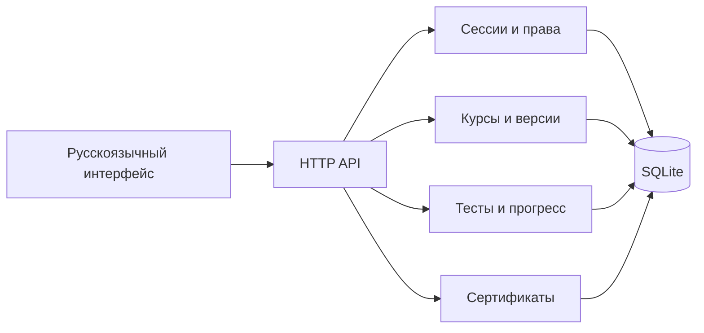

# Edentica: техническое видение и первая итерация

Этот документ сохраняет первоначальное видение и исторические отчёты. Текущее состояние описано в [current-status.md](current-status.md); нижеследующие первоначальные ограничения частично устранены.

Миссия: сделать создание качественного образования доступным каждому. Первый продуктовый контур: автор создаёт программу → публикует → ученик записывается → читает материал → сдаёт тесты → получает подтверждение завершения. Критерий готовности контура — серверные проверки всех переходов и сохранение данных после перезапуска.

## Архитектура

Локальный модульный монолит на Node.js 22, встроенный HTTP-сервер, SQLite с внешними ключами и WAL, браузерный интерфейс без зависимостей. Выбор позволяет сразу запускать приложение в доступном окружении без установки пакетов. Это начальная основа, а не утверждение о готовности коммерческого SaaS. Рекомендуемый дальнейший стек: TypeScript/React, PostgreSQL, отдельные фоновые workers и S3. SQLite подходит для локального пилота с одним экземпляром сервера.

## Данные и доступ

users → sessions; users → courses → modules; users ↔ courses через enrollments; users → attempts и progress → modules; users → xp; courses → invitations, course_versions, certificates. Составные уникальные ключи предотвращают повторные записи, начисление XP и выдачу нескольких сертификатов. Все запросы параметризованы. Правильный ответ хранится на сервере и доступен только владельцу в редакторе. Частный курс доступен владельцу и зачисленным ученикам; токен приглашения имеет срок, лимит и отзыв. Административные и корпоративные роли пока не реализованы.

Версии сохраняются перед изменением черновика. Откат через UI пока отсутствует. Опубликованный курс неизменяем: изменение учебной программы с существующими результатами требует следующей модели версий и привязки enrollment к версии.

## API

GET /api/me, /api/courses, /api/dashboard, /api/courses/:id, /api/courses/:id/invitations, /api/certificates/:id.

POST /api/auth/register {name,email,password}; /login {email,password}; /logout. POST /api/courses {title,description,category}. PATCH /api/courses/:id {title,description,category,visibility,modules:[{title,content,threshold,questions:[{text,options,answer}]}]}.

POST /api/courses/:id/publish, /enroll; /invite {days,maxUses}; /certificate {name}. POST /api/modules/:id/attempt {answers:number[]}. POST /api/invitations/accept и /revoke {token}. Ошибки: {error:string} и HTTP 400/401/403/404/405/409/413/429.

## Дизайн

Светлая sage-палитра, тёмная тема, боковая навигация, крупная типографика и спокойная иерархия. Русский интерфейс, семантические формы, видимые состояния ошибок, адаптация к телефону. Полный аудит WCAG 2.2 AA ещё не выполнен. Строки пока размещены в коде; вынос в локализацию — отдельный этап.

## План с зависимостями

1. Текущая итерация: ручной редактор, auth, каталог, тесты, прогресс, приглашения, проверяемый сертификат. Результат — локальный учебный контур.
2. Следующая: типизированные контракты, серверный PDF/QR, финальный экзамен, история попыток, аудит и восстановление версий, email verification и сброс пароля. Редактор вопросов и восстановление приглашения после регистрации реализованы во второй итерации.
3. AI Studio: подключение выбранного провайдера после настройки секрета; JSON schema, серверная валидация, очереди в БД, идемпотентность, отмена, таймауты, бюджет, предварительный просмотр и подтверждение. Без ключа — явная недоступность, без имитации генерации. Источники и проверка качества обязательны; чувствительные темы требуют экспертной проверки.
4. Media: презентации → TTS → видео. Адаптеры провайдеров с явными capabilities; подтверждение прав, журнал согласий, отзыв и удаление материалов. Перед выбором провайдера необходимы актуальные исследования API, стоимости и условий; в этой итерации такое сравнение не выполнено.
5. PostgreSQL, worker queue, S3, observability, резервное копирование и проверка восстановления; безопасность staging; только затем разрешённое production-развёртывание.
6. Социальные функции, рейтинги, отзывы завершивших курс, организации, конструктор сайтов, монетизация.

## Ограничения первой итерации

Нет AI-генерации, видео, презентаций, оплаты, OAuth, MFA, почтовых уведомлений, сброса пароля, загрузки файлов, отзывов и рейтингов, финального экзамена, длительности курса, сложных типов вопросов. PDF сохраняется печатью браузера, серверного генератора нет. Сертификат публичен по случайному ID и раскрывает подтверждённое имя; при развитии продукта требуется отдельное согласие на публичность и отзыв сертификата. Локальный rate limit хранится в памяти и сбрасывается при перезапуске. Не запускать этот пилот как открытый production-сервис.

## Отчёт этапа

Созданы: package.json, .env.example, Dockerfile, server.mjs, src/database.mjs, public/index.html, public/app.js, public/style.css, tests/platform.test.mjs, scripts/demo.mjs, docs/architecture.md. Изменён readme.md. Результаты проверок и инструкция запуска — в README. Git-операции не выполнялись.

## Итерация 2: удобное создание тестов

Реализован редактор вопросов с добавлением и удалением вопросов и вариантов, выбором правильного ответа, клиентской проверкой заполнения и серверной проверкой структуры. При удалении правильного варианта автор обязан выбрать новый. Ограничения: 1–30 вопросов, 2–6 вариантов. Опубликованные тесты остаются неизменяемыми. Приглашение хранится в sessionStorage вкладки до успешного зачисления и восстанавливается после входа/регистрации.

Создан public/assessment-editor.js. Изменены public/app.js, public/style.css, server.mjs (выдача JS-модуля), tests/platform.test.mjs, readme.md и этот документ. Проверки: синтаксис JS; интеграционный контур дополнен отказом при некорректном правильном ответе. Визуальная проверка интерфейса через инструмент браузера остаётся недоступной. Следующий этап: серверный PDF, финальный экзамен, AI-провайдер. Git-операции не выполнялись.
