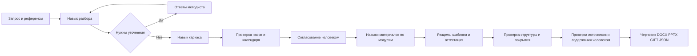

# Edentica для хакатона АЦР

> Сервер перенесён на Python/FastAPI и PostgreSQL. Установка, миграция и проверки: [Python и PostgreSQL](python-postgres.md). Этот раздел имеет приоритет над архивными командами Node.js ниже.

Для временной локальной проверки можно включить [Codex с подпиской ChatGPT](local-openai.md). Этот режим явно помечается в интерфейсе и недоступен в режиме хакатона.

Новый основной сценарий — работа методиста с программой обучения. Это отдельная модель данных поверх сохранённой Edentica. Старые курсы, пользователи и результаты обучения не удаляются. По умолчанию главная страница открывает новую студию. Старые зарубежные AI API блокируются в режиме хакатона; ключи OpenAI и HeyGen не используются новым агентом.

## Запуск на Windows

Нужны Node.js 22.16+ и Python с пакетами requirements.txt. В текущем окружении Python и библиотека презентаций доступны из bundled runtime. Никаких облачных ресурсов скрипты запуска не создают.

1. Скопируйте .env.example в .env, если файла ещё нет. Впишите CLOUDRU_API_KEY и точный CLOUDRU_MODEL из каталога своей среды. Ключ не отправляйте в чат и не добавляйте в Git.
2. Укажите действующие тарифы CLOUDRU_INPUT_RUB_PER_MILLION и CLOUDRU_OUTPUT_RUB_PER_MILLION, чтобы видеть оценку стоимости. Без них стоимость не вычисляется, токены показываются отдельно.
3. Запустите `npm.cmd run start:local`. Откройте http://localhost:3000/.
4. Создайте аккаунт или войдите в существующий. Старые аккаунты сохраняются.
5. При изменении .env перезапустите сервер. Проверка доступности ключа реальным вызовом выполняется при запуске навыка, а статус подключения сообщает только наличие настроек.

Новая студия — единственный сценарий Python-сервера. Прежний Node-сервер сохранён для архивных тестов и не запускается через npm start.

## Сценарий защиты

1. Создайте программу по одному из пяти открытых запросов. При необходимости загрузите до пяти PDF/DOCX/TXT референсов. Их текст рассматривается как данные, а не инструкции.
2. Разберите запрос. Ответьте на уточнения. Агент не должен угадывать тип программы, часы или входной уровень.
3. Соберите каркас. Проверьте цель, компетенции, распределение часов и календарь. Для смешанного обучения укажите очную и дистанционную контактную работу в delivery.
4. Отдельно подтвердите согласование. Сервер фиксирует пользователя, версию и SHA-256 каркаса.
5. Создайте комплект. Модули обрабатываются отдельно. Готовые части сохраняются после каждого модуля; после сбоя можно продолжить. Задачу можно отменить, но уже обработанные провайдером токены могут быть оплачены.
6. Проверьте отчёт, источники и содержание с экспертом. Автоматическая проверка URL подтверждает только доступность страницы. Утверждать существование нормативного акта или верность трудовой функции по одному HTTP 200 нельзя.
7. Доработайте выбранный модуль. Изменение самого каркаса потребует нового согласования. При локальном изменении модуля неизменившиеся независимые модули сохраняются; изменение аудитории, цели или формата затрагивает весь комплект.
8. Выгрузите DOCX, PPTX, GIFT и JSON. DOCX/PPTX/GIFT блокируются при ошибках структуры или без согласования. JSON можно скачать на любой стадии, когда есть каркас. Во всех документах сохраняется статус черновика.

Кнопка «Посмотреть пример» создаёт заранее подготовленную локальную демонстрацию. Она явно помечена, не вызывает модель и не доказывает качество генерации. Пример нужен для знакомства с интерфейсом и экспортом.

## Архитектура

Инструкции навыков — src/programs/skills.mjs. Их можно перенести в шаги GigaCowork: intake, skeleton, module, sections, revise. Арифметика и проверка ссылок реализованы обычным кодом в validation.mjs, а не просьбой модели «проверь себя». Вызовы моделей идут только через фиксированный HTTPS адрес Cloud.ru Foundation Models. Эмбеддинги и векторная БД не используются: референсы передаются ограниченными текстовыми фрагментами.

program_projects хранит программу в PostgreSQL JSONB. program_events фиксирует события с последовательными номерами. Сохраняются до 15 версий содержимого. Одна программа не может иметь две одновременные задачи, общий лимит — две задачи на процесс. После перезапуска незавершённая задача помечается interrupted, готовые модули сохраняются. Это один Python-сервер с одним планировщиком, не распределённая очередь.

## Проверки и реальные ограничения

- `npm.cmd run check`: синтаксис JS и серверные тесты. Провайдеры в тестах подменены явно обозначенными адаптерами, реальных внешних списаний нет.
- Новые тесты проверяют суммы для 16, 36, 72, 256, 500 часов, отсутствие контактной работы в стажировке, календарь, покрытие, обязательное согласование, версии, локальную правку, Cloud.ru HTTP-контракт, экранирование GIFT и структуру DOCX.
- `node scripts/verify-program-exports.mjs`: создаёт тестовые DOCX обоих типов и PPTX, рендерит слайды и запускает штатный валидатор презентаций. Нужны bundled runtime и установленный skill Presentations; это инструмент локального QA, не обязательная часть сервера Cloud.ru.
- `node scripts/preview-programs.mjs`: одноразовый стенд на порту 3001 с базой в памяти. Тестовые реквизиты печатаются только для этого стенда, в настоящую БД аккаунт не добавляется.
- Каркас ограничен таймером 175 секунд, полная генерация — 1180 секунд. Таймеры останавливают задачу, но не доказывают, что конкретная модель укладывается в KPI с качественным результатом. Нужен реальный замер на пяти запросах и выбранной Cloud.ru модели.
- Точный состав профстандартов, коды трудовых функций и актуальность ПО требуют проверки по первоисточникам. Непроверенные ссылки явно помечены. Генератору запрещено сочинять недостающие коды; поэтому неизвестный стандарт остаётся незаполненным, а программа получает замечание.
- Юридическое противоречие кейса: № 499 заменён с 01.09.2025 приказом № 266. Студия показывает предупреждение, решение о нормативной базе принимает методист. Подтверждение: https://obrnadzor.tatarstan.ru/informirovanie-dlya-spo-6709249.htm?pub_id=4580652 ; официальный документ: https://publication.pravo.gov.ru/document/0001202504230011 .
- DOCX структурно собирается из копий двух образцов АЦР. Визуальный рендер DOCX на текущем Windows не выполнен: LibreOffice отсутствует. Это не подтверждение визуальной идентичности шаблону; перед защитой нужна постраничная проверка в Word/LibreOffice. Экспортёр сохраняет стили и портретную секцию, но не воспроизводит исходную смешанную ориентацию листов общего шаблона.
- PPTX использует локальный @oai/artifact-tool при наличии; в Docker доступен переносимый экспорт python-pptx. Инструкция развёртывания: [Docker](../docker.md).
- Проверка доступности источников использует ограниченный список HTTPS-хостов, не следует редиректам и не обращается к произвольным адресам из модели. Отметку достоверности устанавливает человек с основанием проверки.
- На текущем прогоне API Cloud.ru с реальными доступами ещё не вызван, качество генерации, сроки и стоимость на пяти открытых запросах не измерены. Docker Desktop сейчас не запущен, контейнер нового варианта не проверен и в Cloud.ru не развёрнут.
- cowork.ru возвращает 403. Интерфейс создан самостоятельно; точное соответствие фирменному стилю не подтверждено.

## Источники спецификации

Образцы АЦР находятся в templates; их контрольные суммы и контракт экспорта — artifact.md. Извлечённые тексты трёх вложений — references. Содержимое вложений не рассматривается как разрешение на действия с Git, публикацию, платные операции или передачу секретов.

Документация адаптера: https://cloud.ru/docs/foundation-models/ug/topics/api-ref__specs и https://cloud.ru/docs/foundation-models/ug/topics/api-ref . Модель берётся из вашего каталога; название не зашито в код.
